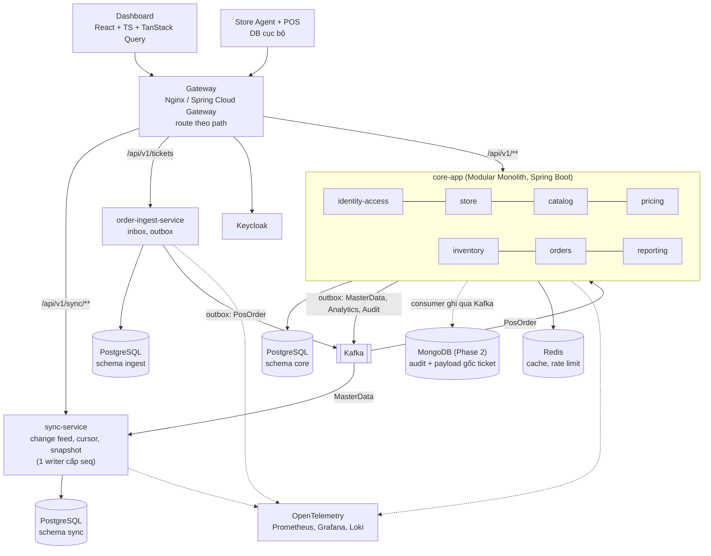

# ADR-001: Kiến trúc lai: core Modular Monolith + 2 service tách sớm (sync-service, order-ingest-service)

- Trạng thái: accepted
- Ngày: 2026-10-08 (đổi sang kiến trúc lai khoảng 2026-10-09; ngày suy ra từ lịch sử commit)
- Giai đoạn: Phase 1

## Bối cảnh
Quyết định ban đầu (2026-10-08) là Modular Monolith thuần vì giá, tồn, đơn dùng chung giao dịch và đội còn nhỏ. Người dùng đổi sang kiến trúc LAI (Hybrid) vì mục tiêu học: README yêu cầu thực hành Spring, Keycloak, Kafka, Redis, MongoDB và deploy, trong đó microservices thật chỉ có ý nghĩa khi có ranh giới tự nhiên. Hai ranh giới tự nhiên đã có sẵn: (1) đường đọc của Store Agent (sync) là đọc nhiều, chỉ cần dữ liệu đã chuẩn bị sẵn, không cần ACID với giá/tồn/đơn; (2) đường ghi ticket của Store Agent (ingest) chỉ cần nhận và giữ ticket an toàn, không cần tạo đơn ngay. Ngược lại giá/tồn/đơn/quyền vẫn cần ACID nên giữ chung trong một deployable.

## Quyết định
Triển khai 3 deployable bằng Docker Compose (chưa Kubernetes): (1) core-app, Modular Monolith Spring Boot gồm identity-access, store, catalog, pricing, inventory, reporting và module MỚI orders (tạo sales_order/order_line/payment + trừ tồn trong MỘT transaction, consume PosOrder); ArchUnit chặn gọi chéo module (chỉ áp dụng trong core-app). (2) sync-service, schema sync riêng, phục vụ change feed cho Store Agent, nhận dữ liệu bằng sự kiện mang đủ trạng thái từ core (ADR-011). (3) order-ingest-service, schema ingest riêng, nhận ticket idempotent, ghi inbox + outbox, publish PosOrder, KHÔNG tạo đơn. Quy tắc chung: service-to-service CHỈ giao tiếp qua Kafka (không gọi REST đồng bộ giữa service ở Phase 1); mỗi service chỉ đọc DB của chính nó (schema per service + user DB riêng + không cấp quyền chéo, cùng một instance PostgreSQL ở Phase 1, tách instance vật lý khi có trigger); mỗi service tự validate JWT (ADR-012); KHÔNG có shared entity library, chỉ chia sẻ contracts/ (OpenAPI, JSON Schema của sự kiện) để tránh anti-pattern 'shared entity library / distributed monolith'. Gateway (Nginx hoặc Spring Cloud Gateway) route theo path. Trigger tách thêm: xem hệ quả.

## Sơ đồ

### Sơ đồ container

## Phương án đã cân nhắc
- Modular Monolith thuần (một deployable): đơn giản nhất, chung transaction, vận hành rẻ nhất; bị loại vì không đạt mục tiêu học microservices thật (Kafka giữa service, JWT mỗi service, contract test, tracing xuyên service) và vì sync/ingest có hồ sơ tải + khả năng sống sót khác core (ingest phải nhận ticket kể cả khi core chết).
- Hybrid: core Modular Monolith + 2 service tách sớm (CHỌN): chỉ tách đúng hai ranh giới tự nhiên, giữ ACID ở core, vẫn học đủ các kỹ năng microservices (event-driven, contract, observability xuyên service) với chi phí vận hành vừa phải.
- Microservices đầy đủ (mỗi module một service: identity, store, catalog, pricing, inventory, orders, reporting...): bị loại vì giá/tồn/đơn cần ACID nên sẽ phải dùng saga, thêm nhiều thành phần cho một người vận hành, dễ thành distributed monolith; chưa có tín hiệu quy mô nào đòi hỏi.

## Hệ quả
- Lợi: giữ ACID cho giá/tồn/đơn; sync-service chạy được khi core-app chết (store vẫn kéo thay đổi đã nhận); ingest vẫn nhận ticket khi core chết; học được microservices thật mà không tách quá tay.
- Trigger xem lại: tách thêm (giả định, đo bằng số liệu): module orders+inventory cần scale riêng ((CPU consumer > 60% khi phần còn lại < 20%, giả định chưa đo, đo ở TASK-023)) thì cân nhắc tách; reporting tải đọc lớn thì tách sang read replica/service; 2+ đội xung đột trên cùng module; cần chu kỳ release khác nhau. Khi tách: ranh giới ArchUnit và outbox/Kafka đã sẵn.
- Đánh đổi: master data tới store trễ thêm vài giây (eventual consistency, RISK-013); thêm +1-2 tuần (ước lượng) nền tảng (CI nhiều artifact, Compose nhiều service, tracing xuyên service, contract test sự kiện: TASK-025, 026, 027, 029).
- Rủi ro: độ phức tạp vận hành tăng (RISK-012); lệch schema sự kiện giữa service (RISK-014); sync-service là single writer nên chạy 1 replica (RISK-015). Kafka trở thành hạ tầng Phase 1, không còn là Phase 2.
- Hệ quả kỹ thuật: Flyway riêng cho từng service; ArchUnit chỉ trong core-app; giao tiếp giữa service được kiểm chứng bằng contract test chứ không bằng compiler (không chia sẻ lớp Java).

## Liên quan
- ADR-011
- ADR-012
- RISK-012
- RISK-013
- RISK-014
- RISK-015
- TASK-025
