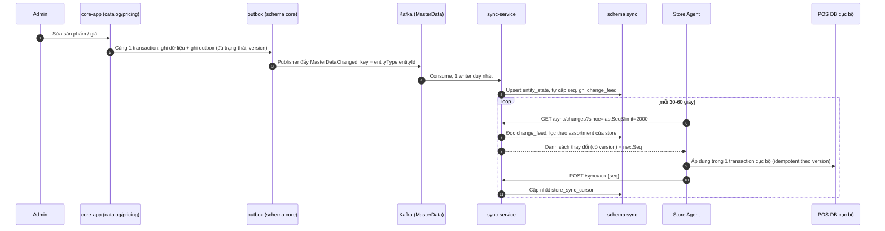

# ADR-002: Cursor-based sync cho master data (pull model)

- Trạng thái: accepted
- Ngày: 2026-10-08
- Giai đoạn: Phase 1

## Bối cảnh
Store phải offline-first, nên Master không thể đẩy. Hệ thống cũ dùng topic 1 partition + consumer synchronized, gây chặn store này chặn store khác. Cần mô hình không chặn giữa store.

## Quyết định
sync-service duy trì change_feed (seq do MỘT writer duy nhất cấp, immutable, ADR-009 mục 8) từ sự kiện MasterDataChanged của core (ADR-011). Mỗi store giữ cursor trong store_sync_cursor (last_seq đã ack). Store Agent gọi định kỳ GET /sync/changes?since=lastSeq&limit=2000 tới sync-service; service lọc theo assortment rồi trả. Agent áp dụng idempotent (có version), rồi ack. Snapshot cho store mới: tải từ read-model entity_state tại seq = X, apply, rồi chuyển incremental từ X. Agent KHÔNG nói chuyện với Kafka: đường Agent <-> Master vẫn là pull cursor.

## Sơ đồ

### Luồng A: master data từ core tới store

## Phương án đã cân nhắc
- Push từ Master (không offline-first, store A offline ảnh hưởng store B)
- Event sourcing từ Kafka (quá phức tạp, Kafka không phải source of truth)
- Bulk snapshot + real-time Kafka (hybrid, nhưng cursor model đơn hơn)

## Hệ quả
- Lợi: store offline không ảnh hưởng nhau, idempotent, dễ replay/recover; sync-service độc lập với core-app.
- Rủi: lag có thể cao, cần monitoring lag per store và lag core -> sync (master_event_lag).
- Kho: phải tách change_feed khỏi dữ liệu gốc, batch update hạn chế để không quá tải; master data tới store trễ thêm vài giây do đi qua Kafka (RISK-013).

## Liên quan
- ADR-009
- ADR-011
- RISK-013
