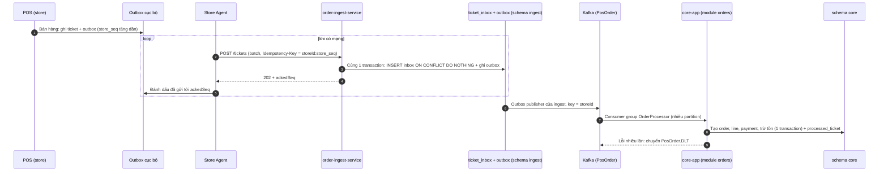

# ADR-003: Inbox + Outbox pattern cho order ingestion

- Trạng thái: accepted
- Ngày: 2026-10-08
- Giai đoạn: Phase 2

## Bối cảnh
Store phải offline-first, nên ticket phải ghi cục bộ trước. Master phải nhận ít nhất 1 lần, không mất, không trùng. Hệ thống cũ dùng synchronized consumer, retry trong static block, dedup bằng SELECT FOR UPDATE gây khóa DB. Trong kiến trúc lai (ADR-001), việc NHẬN ticket (order-ingest-service) tách khỏi việc TẠO đơn (module orders trong core-app) để ingest sống được khi core chết.

## Quyết định
Mỗi store ghi ticket vào outbox cục bộ (store_seq tăng dần). Agent batch gửi POST /tickets tới order-ingest-service với Idempotency-Key=storeId:store_seq. Ingest ghi ticket_inbox với unique (store_id, ticket_id) -> ON CONFLICT DO NOTHING và ghi outbox (TicketReceived) bằng code trong CÙNG transaction; outbox publisher gửi Kafka topic PosOrder với key=storeId (order per store). Ingest KHÔNG tạo đơn. Module orders trong core-app consume PosOrder (consumer group OrderProcessor), dedup lớp 2 bằng processed_event(consumer, event_id) và processed_ticket(store_id, ticket_id), tạo đơn + trừ tồn trong một transaction; lỗi nhiều lần -> PosOrder.DLT. Outbox cũng có ở core-app (MasterData, Analytics, Audit), mỗi service tự cài outbox của mình (không dùng thư viện entity chung).

## Sơ đồ

### Luồng B: ticket từ POS (inbox/outbox)

## Phương án đã cân nhắc
- Không dedup (có trùng, doanh thu cao)
- Dedup bằng application layer (rủi quên đặt unique)
- Không inbox, gửi trực tiếp Kafka (mất khi gửi sai hoặc Kafka chết)

## Hệ quả
- Lợi: at-least-once guarantee, idempotent, một store lỗi không chặn store khác; ingest vẫn nhận ticket khi core-app chết.
- Rủi: phải quản lý 2 store (outbox cục bộ + inbox của ingest) và dedup ở hai service; schema phức tạp hơn; 202 chỉ có nghĩa đã ghi inbox, đơn được tạo bất đồng bộ.
- Kho: DLQ phải monitor và manual intervention để fix poison message; trạng thái xử lý đơn nằm ở core (processed_ticket), ingest chỉ biết RECEIVED/PUBLISHED/REJECTED.

## Liên quan
- ADR-001
