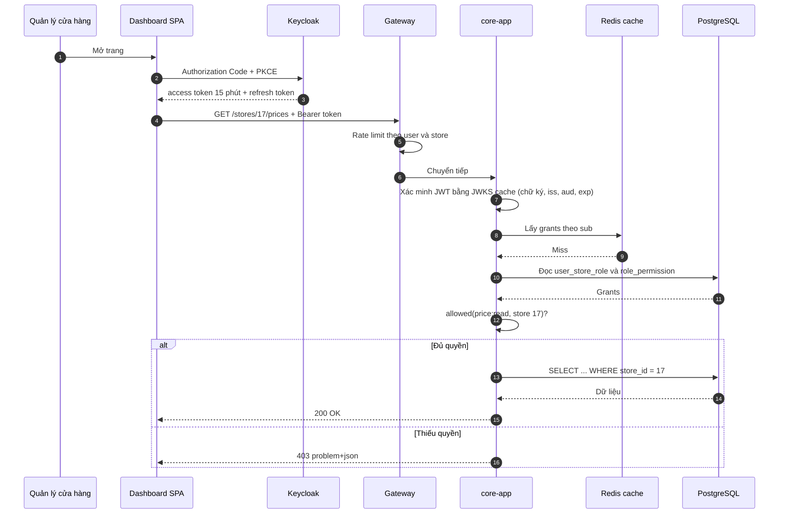

# ADR-005: Keycloak + OIDC + local credential cache cho Agent

- Trạng thái: accepted
- Ngày: 2026-10-08
- Giai đoạn: Phase 1

## Bối cảnh
Dashboard là web app (browser OIDC), Store Agent là desktop/mobile app (offline, slow network). Keycloak chết thì dashboard không đăng nhập, nhưng Agent phải vẫn chạy.

## Quyết định
Dashboard: dùng Keycloak OIDC, Browser flow. Token có TTL (vd 15 phút). Dashboard lưu refresh token cục bộ. Agent: client credentials (mỗi store một client agent-store-{code}), claim store_id gắn cứng ở Keycloak. MỖI service (core-app, sync-service, order-ingest-service) là resource server riêng: cache JWKS từ Keycloak, xác minh chữ ký/iss/aud/exp offline (ADR-012). Khi Keycloak chết, token còn hạn vẫn dùng được ở cả ba service. Không tin storeId từ client: store_id lấy từ claim trong token (sync/ingest) hoặc đối chiếu identity-access (dashboard, core-app).

## Sơ đồ

### Đăng nhập và kiểm quyền

## Phương án đã cân nhắc
- API Key cho Agent (không scalable, khó revoke)
- Không cache JWKS (phải online kiểm chứng, Agent offline bị khóa)
- Trust storeId từ client (security risk)

## Hệ quả
- Lợi: Agent vẫn chạy khi Keycloak chết, OIDC standard, dễ tích hợp SSO sau.
- Rủi: phải quản lý 2 loại credential, cache JWKS phải refresh.
- Kho: phải rotate credential Agent định kỳ, JWKS cache TTL hợp lý (vd 1 ngày).

## Liên quan
- ADR-012
