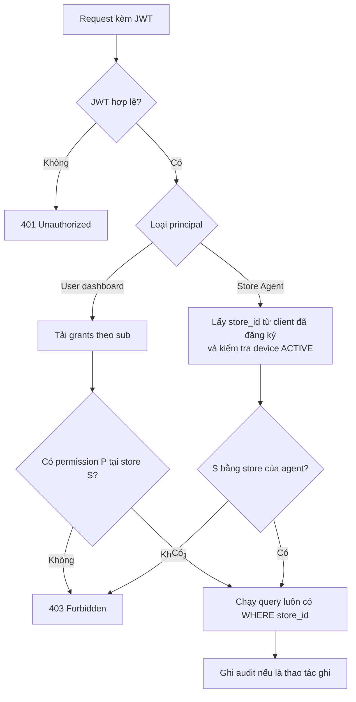

# ADR-007: Phân quyền (Authorization): RBAC có phạm vi, quyền lưu ở PostgreSQL

- Trạng thái: accepted
- Ngày: 2026-10-08
- Giai đoạn: Phase 1

## Bối cảnh
Một người có vai trò khác nhau ở nhiều store (ví dụ quản lý store 17, nhân viên store 22). Nhét role theo store vào token làm token phình và lỗi thời. Cần chống BOLA/IDOR. Bổ sung cho ADR-005 (ADR-005 lo xác thực, ADR-007 lo 'ai được làm gì').

## Quyết định
RBAC có phạm vi (scope GLOBAL / REGION / STORE) lưu ở user_store_role + role_permission trong PostgreSQL (schema core), áp dụng cho NGƯỜI DÙNG dashboard trong core-app. Token chỉ định danh (ADR-005). core-app kiểm tra allowed(permission, storeId) ở mọi endpoint, cache grants 60 giây (giả định, cần đo ở TASK-023) (L2 Redis theo ADR-008). Store Agent (service account) KHÔNG đi qua grants: sync-service và order-ingest-service lấy store_id và quyền cố định (sync:pull, ticket:ingest) từ claims trong JWT (ADR-012); core-app vẫn đối chiếu storeId của Agent với DB khi cần (xem TASK-006).

## Sơ đồ

### Cây quyết định phân quyền

## Phương án đã cân nhắc
- Role đặt trong Keycloak/token (token phình, lỗi thời, phụ thuộc Keycloak)
- ABAC với OPA hoặc Keycloak Authorization Services (mạnh nhưng nặng cho quy mô hiện tại)
- Chỉ dùng PostgreSQL Row Level Security (có thể thêm sau như lớp phòng thủ thứ hai)

## Hệ quả
- Lợi: đổi quyền có hiệu lực trong vài chục giây, token nhỏ, dễ test bằng bảng ví dụ, không phụ thuộc Keycloak để kiểm quyền.
- Rủi: tự duy trì module quyền; mỗi request thêm một lần tra cache.
- Kho: seed role_permission bằng Flyway; bộ test ma trận quyền (TASK-004) chạy ở CI; RLS có thể thêm sau.

## Liên quan
- ADR-005
- ADR-008
- ADR-012
- TASK-004
- TASK-006
