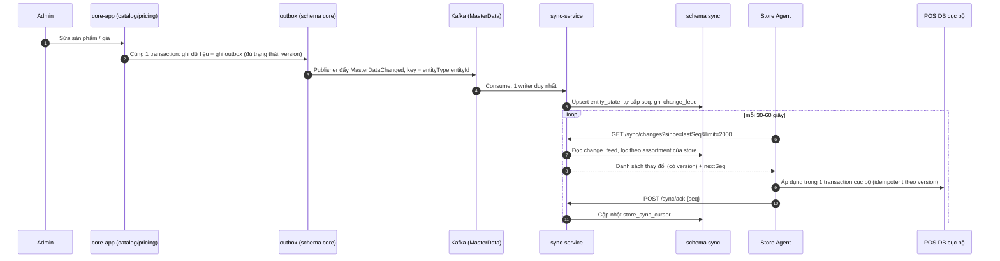

# ADR-011: Event-carried state transfer từ core sang sync-service (thay vì sync-service đọc DB của core)

- Trạng thái: accepted
- Ngày: 2026-10-08
- Giai đoạn: Phase 1

## Bối cảnh
sync-service cần dữ liệu master (product, category, brand, supplier, store_product, store_price) để dựng change feed và snapshot, lọc theo assortment của store. Dữ liệu do core-app sở hữu và ghi (ADR-009 mục 1). Quy tắc của kiến trúc lai: mỗi service chỉ đọc DB của chính nó, service-to-service chỉ qua Kafka (ADR-001). Ngoài ra seq của feed cần thứ tự rõ ràng, tránh vấn đề seq bỏ sót do commit không theo thứ tự (ADR-009 mục 8 cũ).

## Quyết định
core-app ghi outbox sự kiện MasterDataChanged cùng transaction với dữ liệu, mang ĐỦ trạng thái (event-carried state: entityType, entityId, op UPSERT/DELETE, version, storeId nếu có, state đầy đủ, changedAt). Publisher đẩy lên topic MasterData (key = entityType:entityId để giữ thứ tự theo thực thể). sync-service consume bằng MỘT writer duy nhất, trong mỗi transaction: upsert entity_state (bỏ qua nếu version nhỏ hơn hoặc bằng), tự cấp seq tăng dần theo thứ tự consume, ghi change_feed kèm state. Khi một STORE_PRODUCT ACTIVE được thêm, writer ghi thêm một dòng PRODUCT nhắm riêng store đó (store_id = S) lấy từ entity_state để store mới có đủ dữ liệu sản phẩm (đề xuất, cần kiểm thử). Snapshot lấy từ entity_state. Phục hồi: job MasterDataRepublish của core phát lại trạng thái hiện tại của mọi thực thể (idempotent nhờ version); không dùng Kafka làm nguồn sự thật dài hạn (retention 7 ngày, giả định). Contract: contracts/events/master-data-changed.schema.json + contract test ở CI (TASK-026).

## Sơ đồ

### Luồng A: event-carried state

## Phương án đã cân nhắc
- sync-service có role read-only vào schema core: đơn giản và không trễ, nhưng gắn chặt hai service vào cùng schema (đổi bảng core phải đồng bộ với sync), phá nguyên tắc mỗi service chỉ đọc DB của mình, và không còn học được event-driven; loại.
- sync-service gọi REST pull vào core-app: vi phạm 'không gọi REST đồng bộ giữa service ở Phase 1', sync mất khả năng chạy độc lập khi core chết; loại.
- CDC (ví dụ Debezium) đọc WAL của core rồi đẩy Kafka: không cần code outbox nhưng thêm thành phần vận hành và lộ cấu trúc bảng nội bộ thành hợp đồng; để dành làm phương án thay thế sau này.
- Sự kiện chỉ mang id (notification) rồi sync gọi lại core lấy state: thêm phụ thuộc đồng bộ; loại.

## Hệ quả
- Lợi: sync-service độc lập khi core chết; seq do single writer cấp nên đúng thứ tự mà không cần khóa advisory; feed không còn N+1 vì state nằm trong sự kiện; snapshot lấy từ read-model của chính service.
- Đánh đổi: eventual consistency, store nhận master data trễ vài giây (đo bằng master_event_lag, RISK-013); dữ liệu được lưu hai nơi (core là nguồn sự thật, sync là bản chiếu) nên cần job đối chiếu checksum và MasterDataRepublish.
- Rủi ro: lệch schema sự kiện (RISK-014): bắt buộc contract test producer/consumer, schemaVersion N và N-1; Kafka chết thì outbox của core tích lũy, feed không có thay đổi mới nhưng store vẫn kéo phần đã có.
- Kho: sự kiện lớn khi state lớn (giữ state gọn, không nhúng quan hệ); thứ tự giữa các thực thể khác nhau không được bảo đảm (chỉ theo key) nên Agent phải chịu được product đến sau store_product (đã có version và áp dụng idempotent).

## Liên quan
- ADR-001
- ADR-009
- RISK-013
- RISK-014
- TASK-026
